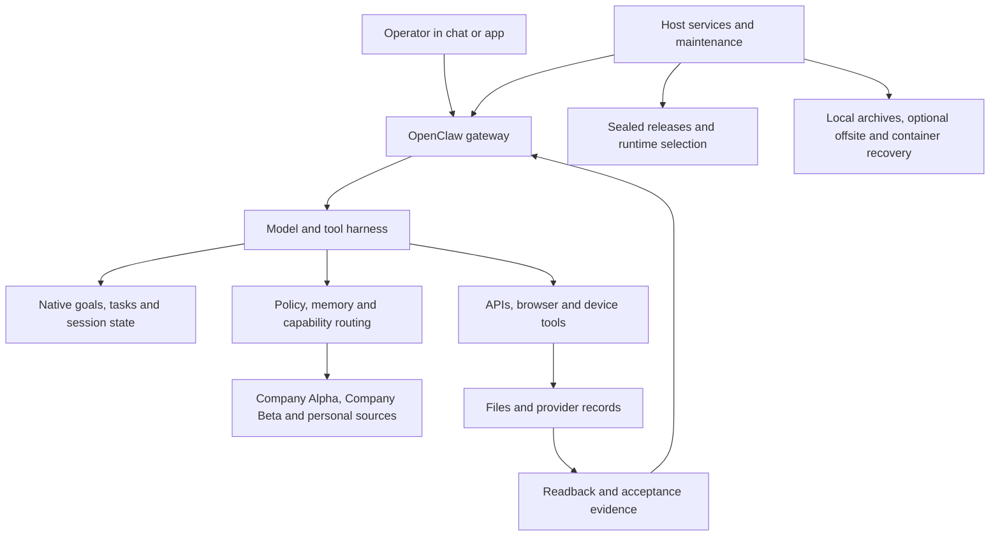

# OpenClaw Control Plane

A reproducible reference for a customized **OpenClaw** installation: runtime
changes, substantial agent instructions, integration routing, release management and
host operations for a persistent single-operator assistant.

The aim is practical. An operator should be able to ask for useful work in ordinary
language, leave a task running, return through the same conversation and inspect what
actually happened. The assistant should know which sources and accounts to use, carry
unfinished work across context changes and verify the resulting files or provider
records before saying it is done.

Company Alpha, Company Beta and the Personal Data Project are consistent example
identities. Their procedures remain substantial; accounts, host paths and data are
supplied by the adopter.

The latest qualified source reference is
[`70413d04c280cd35cd41e8eb3942d2def4c15e89`](runtime/README.md#october-14-browser-lint-style),
with native reference `376af34f3a2cc9178b83e9e76dfcb1139ef82a7d`.
It corrects two Browser lint forms while preserving strict cleanup semantics and
all revocation cases. All 125 owning cases, targeted typed lint and guarded
Browser types pass. This source-only successor preserves installed R10 and all
of its separate activation and ordinary-use acceptance evidence.

The dated October 13 installed source reference is
[`9e6b7524b6eaf0e10700715c62b3fd71c659c582`](runtime/README.md#october-13-browser-and-deferred-voice-recovery),
with matching native `1ec7fe1273609ef5b774a304dfb07460ae57cd22`.
Fatal errors after the first authenticated speaker now reach the current auto-join
owner before room retirement, preventing repeated physical rejoins while retaining
explicit recovery and transient retries. Browser cache setup tolerates allowed
navigation; bounded diagnostics distinguish targeting, post-action uncertainty
and closed targets without automatic action retries. Source checks, one preserving
R10 activation and independent loaded-source, health and protected-state readback
pass. Native Chrome reload and Browser navigation/readback/owned-tab cleanup also
pass; final hosted checks remain pending. Earlier human
voice acceptance is retained separately.

The dated October 13 authenticated-speaker test reference is
[`b62983e9d2a1b15a1b6a04fba20d428c9ba29700`](runtime/README.md#october-13-authenticated-speaker-test-fixtures).
It corrects three stale voice test fixtures to admit authenticated speakers and
inspect their actual connections. All 86 affected cases pass with cancellation,
cleanup and isolation assertions intact. Production source and the installed
`a33002eb` / native `87ec8a44` release remain unchanged. After the reviewed native
profile recovery, the operator reported stable answers in personal and company
rooms, consultation acknowledgment and a completed spoken reply, and the
preferred voice. Exact company source values were not independently
transcript-correlated; no measured speech latency is claimed.

The dated October 13 authenticated owner voice reference is
[`e92f9a192ba16647bc2fe3e43c290d63c3606c18`](runtime/README.md#october-13-authenticated-owner-voice-context).
Authenticated realtime voice preserves speaker-scoped primary and room policy,
uses permitted records consultation for factual checks, and retains queued
microphone replies and playback ownership. All 376 affected cases passed on
that dated predecessor source, which was never installed. Before building, the
actual keyed roster with an explicit system owner exposed a resolver error. The
latest `a33002ebbb05dd80895740550c0eceb4c85da8cd` /
`87ec8a444396313d90d00022cc2ed1dfa511adab` source corrects it and passed 71 focused
cases. Installation and genuine-call acceptance retain separate proof boundaries.

The dated October 13 realtime voice reference is
[`55ffb6953eb7179233a45aa942966769b6efcdd5`](runtime/README.md#october-13-realtime-voice-reliability).
Realtime voice retains whole selected policy/profile context, uses the normal
response queue for microphone replies when interruption is disabled, and checks
records through the agent consult for missing or fresh facts and actions.
All 289 affected cases pass. The one-file documentation hash successor preserves
entry counts, core/plugin output and the frozen 27 voice files.
Current source references are distinct from the frozen R8 build/seal and the
retained dated installation; real-call and screenshot acceptance remain separate.

The dated October 13 configuration documentation reference is
[`c3298d804165eb5ca5f41815d04dbcf4e8a7e4d3`](runtime/README.md#october-13-discord-config-documentation).
The ordinary configuration documentation generator now records exactly the 18
expanded entries from the previously approved Discord voice schema. Channel
count is 3762; core/plugin counts and strict hash/count guards are unchanged.
The 11 baseline cases pass; the remaining native-plan commands are qualified
through their actual owners after correcting one existing type-consumer edge.
This generated documentation successor keeps the accepted R7 installation and
preferences intact. Genuine-call audible behavior remains pending.

The dated October 13 source-layout reference is
[`a11e067ec72a5b9a8ff545842cb0d9758df8ae16`](runtime/README.md#october-13-discord-line-cap-layout).
The existing realtime agent-turn and connection helpers now live in coherent
sibling modules. The unchanged line-limit guard, 87 existing voice cases and
scoped guarded types/lint pass. This is a source-layout successor; the accepted
R7 installation remains native `7f24ca48066872381f1b50bdcc592cdc599b3cff`.
Genuine-call audible behavior remains pending. Prior source qualifications,
installed-state receipts, native archive and overlay are retained.

The dated October 13 generated-metadata source reference is
[`d24b93a980874a5fd4e3de9cb6c95f0b43d5b96f`](runtime/README.md#october-13-generated-discord-voice-metadata).
Generated plugin metadata now accepts the configured global voice policy and a
narrow guild override, while rejecting provider selection inside that override.
The two-file successor passed all 46 metadata validation cases and normal
generator/type/lint checks. The matching native R7 build, stage and seal passed.
Gateway and Node now load native `7f24ca48066872381f1b50bdcc592cdc599b3cff` following
one preserving activation and independent loaded-source, health and protected-state
readback. Genuine-call audible behavior remains
separate pending work. Every prior dated record and all five required hosted
checks are retained.

The dated October 13 voice qualification source reference is
[`206539510310836f6a8f1d18867423f73fac43a6`](runtime/README.md#october-13-discord-voice-yield-and-guild-policy).
Yielded voice work stays pending until its original requester receives the resumed
final. Independent overlapping work retains its own delivery owner through later
turns and speaker replacements. Guild voice policy separates conversational replies
from action handoff, while new rooms inherit the routed profile context. The
combined qualification passed 428 focused cases and affected guarded type/lint
checks. Gateway and Node now run the matching native R6 distribution
`975df1fbb861664c075ed31a18394b173da666f9`. Normal build/stage/seal, single
preserving activation and independent loaded-source, health and protected-state
readback passed. New voice settings and actual audible call acceptance remain
separate pending work.
The native archive, two-file overlay and every prior dated record are retained.
All five established public checks are required on the final changed head.

The dated October 13 npm qualification source reference is
[`cef94b88fa6f8a828c8544b401dd5484e878a40f`](runtime/README.md#october-13-frozen-npm-override-contexts).
It is a test/build-tool successor to the installed Discord route repair. npm lock
generation now repairs a demonstrated lost override context only when every raw
request agrees with its frozen parent branch, then verifies the actual resolved
branch and unchanged version/integrity guard. The source qualification passed
125 focused cases, affected guarded types and scoped lint. Gateway and Node remain
on installed R5 `b91ea6fd08bab3d57aebbd7a37d251cd68823931`; no new runtime build or activation is claimed.
The native archive, two-file overlay and every prior qualification remain intact.
All five established public checks are required on this successor's exact head.

The dated October 12 installed route source reference is
[`24218cc58e388c932e6a6420568ce2c86ab9a653`](runtime/README.md#october-12-discord-own-channel-route).
The route normalizer now recognizes a Discord thread component that repeats its
explicit channel destination. This allows a retained child completion to match its
original unthreaded conversation while preserving distinct threads and the existing
session, run, source, account and generation checks. The four changed source/test
paths passed 62 focused cases. Gateway and Node now run native distribution
`b91ea6fd08bab3d57aebbd7a37d251cd68823931`. The matching normal build, stage, seal,
first activation and independent loaded-source, health and protected-state readback
passed with separate receipts. The native archive, package overlay, prior
qualification records and signed companions are retained. The five established
public hosted checks remain required on the changed head; installed source identity
does not establish future provider-task nonrecurrence.

The dated October 12 timeout source reference is
[`1258a28376a4c6fd22f69746abd98e8f97eba146`](runtime/README.md#october-12-normal-agent-cli-timeout).
Gateway and Node run native distribution `ce47d1a7963b6405abbc17d54f843c6a2aa63838`.
Normal agent CLI omission now uses the shared 48-hour timeout default. Configured
and explicit finite or zero values keep their behavior, while `agent exec` retains
its separate 600-second default. Scoped source qualification, the matching build
and actual installation have separate receipts. Earlier fixture/native/console
records, production console files, native archive and Signed618 companions remain
intact. All five hosted jobs are required on the updated head.

The dated October 12 fixture source reference is
[`24a128f31bc538dae046419201cd6f8bbbe68f2f`](runtime/README.md#october-12-native-fixture-contracts).
Gateway and Node run native distribution `6acbdd077d19fc9ca39854152a72ce15079554f3`.
Two recovery/native fixtures now satisfy their existing required-message and
persisted canonical parent-envelope contracts. Owning fixture qualification,
the matching build and actual installation have separate receipts. Both earlier
dated qualifications, production console files, native archive and Signed618
companions remain intact. All five hosted jobs are required on the updated head.

The dated October 12 metadata and continuation source reference is
[`a7531113eb22e82cd2fb3e94457e8707de07b2ad`](runtime/README.md#october-12-mac-metadata-and-native-resume-continuation).
Gateway and Node run native distribution `3dfd9f4453e791a0c2dfa3d7ee47caadac2b29f4`.
Requester-source validation now precedes resume adoption, preserving the paused
read transfer until it is validated. Approved Mac CLI/TUI platform pins and existing
spawn owners retain their ordinary behavior. Owning source checks, built-runtime
native continuation and normal installation have separate receipts. The October11
console repair and installed measurements remain dated, with production console
source unchanged. Signed618 companions and prior records remain intact. Fresh
public checks and all five existing hosted jobs remain required.

The dated October 11 source reference is
[`11f85c78fc5b7e978261de3e41aeb189a3d53113`](runtime/README.md#october-11-recent-context-tool-authority-and-console-ownership).
Gateway and Node run native distribution `d3e26bf98ca679d8cd76a604bf57115242d361ff`.
The new source retains recent compaction inputs, explicit full child tool policy,
native worker authority, source-bound completion recovery, full-profile system
review tools and peer-owned console-object cleanup. The guarded core check,
combined build, first activation and independent loaded-state preservation passed.
Installed isolated Chromium measurement released 2,000 console objects and kept
500 text messages; one ordinary native child retained its parent's available
Computer authority and returned its completion to the original parent. These observations
have separate scopes. Signed618 companions and all earlier records are unchanged.
Fresh public checks and all five existing hosted jobs remain required for this
reference; source and installation alone do not close broader ordinary-use work.

The dated October 10 source reference is
[`47d8345038628f1a6cb20a64ba3cba16d5f3efc2`](runtime/README.md#october-10-source-reference-and-installation-boundaries).
Its native distribution is `4f73fbf792a915051eb6895f8472e8c055f756eb`;
the source trees differ only in the retained package YAML overlay.
The saved-call owner and the readable, dated-context prompt retain their separate
source qualifications. The existing summary-model owner passed 30 cases and the
required changed checks passed. Earlier requester, routing, catalog, native and
fixture qualifications retain their original dated receipts.

Gateway and Node now run that native distribution. Normal build, stage, seal,
first activation and the fresh independent loaded-source observation passed at
`2026-10-10T22:50:31.752423Z`, with same-generation, health and protected-state
preservation verified. The original loaded001 approvals-inspection failure stays
recorded; the later unchanged reader passed separately, without establishing the
original failure's cause. Both signed 618 companions retain source
`b6c925c4875d83abfb43b6587e7c9966b3634520` and their complete installed/rollback maps,
worker/cohort, preservation and paired-reconnection evidence. The complete prior
public Gateway chain, including 496, 9fe, 36f and 616, remains intact. The intervening
6f installation retains its separate dated private receipts.

The separate uncoached Mac saved-credential unlock remains native acceptance;
provider authorization is separate. Earlier catalog discovery and unchanged-grant
reuse retain their dated acceptance. An ordinary model run on October 10 used
existing records and all 70 genuine utterances in order, preserving raw capture and
metadata. The saved notes and normal exports passed independent readback, with four
readable overview paragraphs and dated historical context. The two original minutes
posts were corrected in place, and a useful completion reached the originating
conversation. Future voice follow, move and leave behavior remains unverified.
Provider writes and broader goal completion remain separate; installation and source
qualification alone do not establish ordinary-use acceptance. All five exact-head
hosted checks remain required, and prior failed public checks remain recorded.

The dated October 7 qualified runtime source reference was
[`1f9e9a4caf2525d4aaf41fa2cd3bffe4744bf1eb`](runtime/README.md#october-7-native-child-status-and-cron-fixture-qualification).
At that checkpoint, Gateway and Node ran
[`98eb1d271b1e174707be092dd67be9c424e871ce`](runtime/README.md#october-7-native-child-status-and-cron-fixture-qualification);
the qualified reference differs only in a cron test fixture. Native activation,
loaded-source, health and protected-state checks passed. Both signed companions,
build 605, retain their 4ce source and dated installation evidence.
Previous records remain intact. Fresh local and required hosted qualification,
plus ordinary-use acceptance, remain separate checks.

The dated predecessor installed Gateway and Node source reference was
[`4ce35c658e465161d98dce988729558b55030d22`](runtime/README.md#october-7-continuity-browser-confidentiality-and-authorized-outcomes).
Actual native activation and independent same-generation loaded-source, health and
protected-state readback passed. Both signed companions605 have exact installed
inventory and live bundled-worker source identity readbacks. The preceding57b public
source, baa18/364/753 actual deployments and complete earlier companion histories
remain preserved. Source and installation evidence does not close all ordinary-use
outcomes; fresh local and all five exact-head hosted public checks remain required.

The dated predecessor installed Gateway and Node source reference was
[`57b8a6d654649d3efa13d44a0fe9e3212188c440`](runtime/README.md#october-6-original-task-restart-and-scheduled-context-continuity).
One normal build/stage/seal, native activation and independent loaded-source,
health and protected-state readback passed. The successor preserves original CUI
restart continuity, accepted restart cancellation and full eligible scheduled-task
instructions unless light context is explicitly selected. Signed companions 603
remain 470392 and all 19 ordinary-use outcomes remain open. The dated 1887
intermediate installation and complete preceding qualification history are retained.
Fresh public local and exact-head hosted qualification are required separately.

The dated predecessor installed Gateway and Node source reference was
`34ae633fbd5f5cf90277adb58eda2ba56d929bd8`, with separately qualified native parent-task
context and original-outcome completion protocol. See the
[dated predecessor source qualification](runtime/README.md#october-6-native-parent-task-context-and-completion-protocol).
Normal activation and exact loaded-generation readback are separate from ordinary
account, browser, Discord and task acceptance; all nineteen outcomes remain open.

The dated predecessor installed Gateway and Node source reference was
`1214d0ff7999bfbf0b548701d5ae6a9486236b6a`, with separately qualified original-task
continuation and requester tool recovery. See the
[dated predecessor source qualification](runtime/README.md#october-6-original-task-continuation-and-requester-tool-recovery).
Normal activation and exact loaded-generation readback are separate from ordinary
account, browser, Discord and task acceptance; all nineteen outcomes remain open.

The dated predecessor installed Gateway source reference was
`2d8406b58affbeed037ec2d739704fa835d31e05`, tree
`9448813217d29446d3a412bf0d594c08a39395a8`. Its 28-path successor covers complete
meeting finalization, exact private-task transcript recovery and tool-aware
owner-authorized host maintenance. The full normal build, staging, offline import
and seal passed, followed by one activation at 21:50:10 UTC and independent
same-generation health and protected-state readback. The generic policy template
carries the original outcome through
implementation, verification and authorized delivery. This public revision requires
normal local qualification and all five exact-head hosted checks. See the
[dated predecessor runtime qualification](runtime/README.md#october-5-authorized-follow-through-and-complete-meeting-finalization).

The preceding dated installed Gateway projection was `eb0ae40d72f2004a83a484b89084f2f337239039`,
source tree `39a8e0354e4dcd6260ae3dfad88c1706d312c11b`. Its twelve-path
successor lets explicitly repair-capable command jobs make one native repair
attempt inside the original authority and deadline; a fresh deterministic command
owns the final result. Source qualification, build, stage, seal, activation and
loaded-source health checks passed. Actual adaptive-job effects, capacity
restoration and ordinary-use acceptance remain separate. Both Mac hosts retain
signed companion603 from `470392c53831b43342ddf7795d04e41638742589`.
UI PR54 is not installed. The [runtime qualification](runtime/README.md#october-5-command-repair-with-deterministic-verification)
retains prior recall and installation evidence with their original limits and
the open nineteen-item acceptance matrix.

The dated October 3 source reference is `04adc9cec81f56cfe6fc8b418178b719099f1a1c`,
source tree `18f6cc162cab880dbe2f07ccb2220f7937fa5251`. It includes the
foreground shortcut repair and the qualified browser registration collision fix.
At that checkpoint both Mac companions ran signed build 601; Mini shortcut replacement and saved-alias
Apple Passwords unlock passed. The Gateway then ran this corrected source with
health and protected settings verified. Normal native-browser registration passed;
browser login, Bitwarden reuse and genuine spoken-audio/minutes remain pending.
The [runtime qualification](runtime/README.md#october-3-foreground-shortcuts-and-browser-bootstrap-migration)
keeps those source, installation and ordinary-use scopes separate.

The dated build 600 source reference is `dfcb9c9410f4bde9a6bab69437050aa76d4d6b4e`,
source tree `6c7f113dda8684378c7a7810add963178a6674f2`. Its two auth-bootstrap
changes let the local Mac credential reader validate core Gateway settings without
being blocked by unrelated newer channel metadata. The existing credential,
signed-parent, private-pipe and whole-config checks remain.

Mini companion build 600 and its matching worker passed normal packaging,
installation/readiness and signed local-auth acceptance. Opaque entry unlocked the
normal Apple Passwords landing; vault-item retrieval and Bitwarden reuse are not
claimed. An October 3, 18:18 UTC readback accepted MacBook build 600 in its
existing remote mode and one native metadata command; credential acceptance remains
separate. The [runtime qualification](runtime/README.md#october-3-mac-companion-authentication-bootstrap)
records the scoped source and host evidence. That dated acceptance retained the Gateway source below.

At the dated build 600 checkpoint, the Gateway successor was
`219dead0bc0ebbe8ab2c255677c8d65d1a6b8b59`,
source tree `b76fabfb1a1e5abffa3fa2fa61394c5f2bdcec9c`. It changes 45 paths
since the earlier published reference `3e7d6ada7440d2094891e1b3964241e64f585c09`.

Configured Discord voice following can now record a followed participant's call
and post meeting notes and action items when the visit ends. Received speech
finishes processing before the notes are finalized. An explicit leave finalizes
that recording once and keeps following paused for the same visit; a real new
visit or move can resume it. Completed workers return to their original logical
conversation after a yielded run. Visible tasks use natural progress messages,
and Discord automation notices omit internal inspection footers while retaining
useful results and controls.

The final integrated native build, including the UI, passed. Readonly staging,
the offline import and candidate seal passed. The isolated Discord startup profile
measured 297.6 MiB peak RSS against a 45.5 MiB baseline; this is an entrypoint
measurement, not running Gateway or combined-plugin memory. One activation installed this exact source
at 15:24:40 UTC on October 3 without rollback. Loaded services, health/readiness
and protected-state readback passed. Voice following and its minutes destination
were configured on the same healthy Gateway; fresh spoken-audio and minutes
delivery remain pending. Current-process capture, context and dated
conversation custody readback passed; interrupted work is preserved, not claimed
resumed. A naturally scheduled Discord announcement matched its summary and omitted
the Inspect section. Exact-public-head hosted checks remain required. Earlier
website, MCP and conversation acceptance records keep their dated scope and were
not repeated for this activation.

## How it works



Start with [the introduction](docs/00-start-here.md) for the complete request flow.

## What is included

- **The complete runtime delta:** all changed paths from the pinned official release,
  including regression tests. The reconstruction helper verifies the patch checksum
  and resulting Git tree. Production source is unchanged from the pinned source;
  two labels in one test fixture are normalized.
- **Identity and working policy:** IDENTITY, AGENTS, SOUL, USER, TOOLS, WRITING,
  bootstrap and memory templates covering the assistant persona and defaults,
  initiative, approval, source authority, tool selection, writing, long work and
  verification. The [identity template](templates/IDENTITY.example.md) preserves the
  source installation's role, defaults and authority boundary with fictional names.
- **Workspace implementation:** capability routing and adapters, release activation,
  guarded maintenance, backup supervision and supporting contracts and tests.
- **Configuration and adoption guidance:** model preferences, context behavior,
  source layout, account setup, operational definitions and acceptance steps.

The runtime [manifest](runtime/manifest.json) is the authority for the official tag,
custom source commit, normalized tree, patch checksum and exact Node.js/pnpm
versions. CI reads those values from the same manifest and verifies the annotated
tag and reconstructed tree before running the source checks and build. A version
label alone does not identify the custom changes.

The [September 30 source map](docs/20-runtime-source-changes.md#september-30-recovery-steering-and-delivery)
describes reference `30ea139bacf0ec56c5f07fe3eb35c27341f47fed`. Follow-up messages can
reach the current execution after recovery publishes its exact owner. Original
requester authority and child-result delivery survive restart and cleanup without
replaying committed work. Discord thread and voice lookup follow the configured
account and channel policy. Native verification keeps ownership of child processes
until cleanup finishes.

The complete patch still covers the pinned official release through this reference.
Its final review includes 129 changed paths since the September 29 reference,
including all 107 changes since the deployed `d10b9c4` predecessor. Dialogue and
automation defaults use GPT-6.1 Sol at Max, with manual Ultra and no automatic
fallback. The [runtime qualification](runtime/README.md#september-30-recovery-steering-and-delivery)
records the source checks, all 18 requester-wake and 32 voice E2E cases, and the
reviewed complete aggregate build. Source and fixture results have separate scope
from an actual channel reply, spoken meeting or provider account interaction.

On September 30, native activation selected the exact `30ea` source and verified both loaded services, health and readiness. Fresh checks preserved configuration, all 28 job definitions, auth orders, approvals, schemas, original session IDs and goal hashes. A new capture verified the current gateway process. This is activation and preservation evidence: ordinary-use steering consistency, process-offline Discord catch-up, account workflows, spoken meeting minutes and the next natural Journal cycle remain separate acceptance checks.

The [September 29 source map](docs/20-runtime-source-changes.md#september-29-continuation-and-activity-corrections)
describes the September 29 reference `4e8c6dc647b164b00f798c85154eac539e891e3f`: preserved task ownership
and steering, bounded Activity recaps, child-result continuation, structured
provider-failure handling, useful progress updates and preemptible maintenance
during yielded idle periods, canonical retained-task-result lookup and summary sizing
that charges only content sent to the summary model. Admitted runs retain their
existing ownership through required preparation and terminal persistence. Premature
normal WebSocket closure retains the existing bounded transport-recovery path. Declared OpenAI reasoning capabilities now expose Max for new models, with optional Max-based Ultra orchestration. It also
retains the earlier voice controls, native credential entry and recovery corrections. Source implementation and tests do not prove
that a gateway, companion or account interaction has been upgraded. The manifest
records exported source and deployed component identities separately: a source
candidate can be newer than the active gateway. Each new installation requires its
own loaded-process and user-path evidence; earlier acceptance retains its dated scope.

The [runtime package](runtime/README.md) preserves earlier repair and acceptance
records under their original source identities. Those historical results do not
qualify a newer manifest, native app or installation.

## Start using the reference

Read the [adoption guide](docs/17-adoption-guide.md) before installing. It separates
source reconstruction, workspace setup, account connection, host installation and
actual user-path acceptance. The [runtime package](runtime/README.md) gives the exact
clone, check, apply and build commands. Installation begins in a separate workspace;
changing an existing service is a later explicit step.

Repository checks use Python's standard library:

```bash
python3 scripts/validate_repo.py
python3 -m unittest discover -s tests -p 'test_*.py'
```

These checks establish repository consistency. Runtime tests, fixture tests for host
helpers and adoption acceptance are separate evidence.

## Reading guide

| Chapter | Purpose |
|---|---|
| [00 Start here](docs/00-start-here.md) | Follow an ordinary request through the system. |
| [01 Glossary](docs/01-glossary.md) | Understand the terminology. |
| [02 Why a control plane](docs/02-why-a-control-plane.md) | See the failures each design choice addresses. |
| [03 Capability provenance](docs/03-capability-provenance.md) | Separate instructions, code and live proof. |
| [04 System architecture](docs/04-system-architecture.md) | Understand ownership between layers. |
| [05 Policy and authority](docs/05-policy-and-authority.md) | Read the instruction hierarchy. |
| [06 Execution and durable lanes](docs/06-execution-and-durable-lanes.md) | Follow native tasks, goals, yields and continuation. |
| [07 Worked example](docs/07-worked-example.md) | Trace a calendar request through source retrieval and readback. |
| [08 Memory and context](docs/08-memory-and-context.md) | Understand retrieval, bootstrap budgets and compaction. |
| [09 Source layout and artifacts](docs/09-source-layout-and-artifacts.md) | Keep source, working data, runtime state and recovery distinct. |
| [10 Runtime releases and promotion](docs/10-runtime-releases-and-promotion.md) | Build, seal, activate and recover a release. |
| [11 Integrations and capability routing](docs/11-integrations-and-capability-routing.md) | Verify routes for the intended account and operation. |
| [12 Scheduling and background work](docs/12-scheduling-and-background-work.md) | Understand native cron and host scheduler ownership. |
| [13 Delivery and the control surface](docs/13-delivery-and-control-surface.md) | Separate task completion from visible delivery. |
| [14 Guards, health and restoration](docs/14-guards-health-and-restoration.md) | Interpret health, containment and recovery evidence. |
| [15 Evidence, audit and verification](docs/15-evidence-audit-and-verification.md) | Match each claim to its actual proof. |
| [16 Security and trust model](docs/16-security-and-trust-model.md) | Define credentials, audience and tool boundaries. |
| [17 Adoption guide](docs/17-adoption-guide.md) | Reconstruct and qualify an installation. |
| [18 Architecture evolution](docs/18-architecture-evolution.md) | Understand the direction and tradeoffs. |
| [19 Host operations and backups](docs/19-host-operations-and-backups.md) | Cover maintenance, optional historical Backblaze templates, Docker/OrbStack and adjacent software. |
| [20 Runtime source changes](docs/20-runtime-source-changes.md) | Inspect the complete patch and source map. |
| [21 Native runtime reconstruction](docs/21-native-runtime-reconstruction.md) | Verify the separately bound native distribution source and archive. |

## Scope and evidence

The reference favors one trusted operator and a macOS host. Core runtime and routing
mechanisms are reusable elsewhere; launchd, Apple applications, native permissions and
Backblaze procedures require platform-specific adaptation.

Policy guides the model. Helpers enforce their own checked operations. Runtime code
implements task and session mechanics. **Live-proven** means an adopter has verified
that behavior on their own installation; importing this repository does not confer
that status. A successful build does not prove account refresh, background device
delivery or a recoverable backup.

MIT licensed. See [LICENSE](LICENSE) and the runtime's
[third-party notices](runtime/THIRD_PARTY_NOTICES.md).
