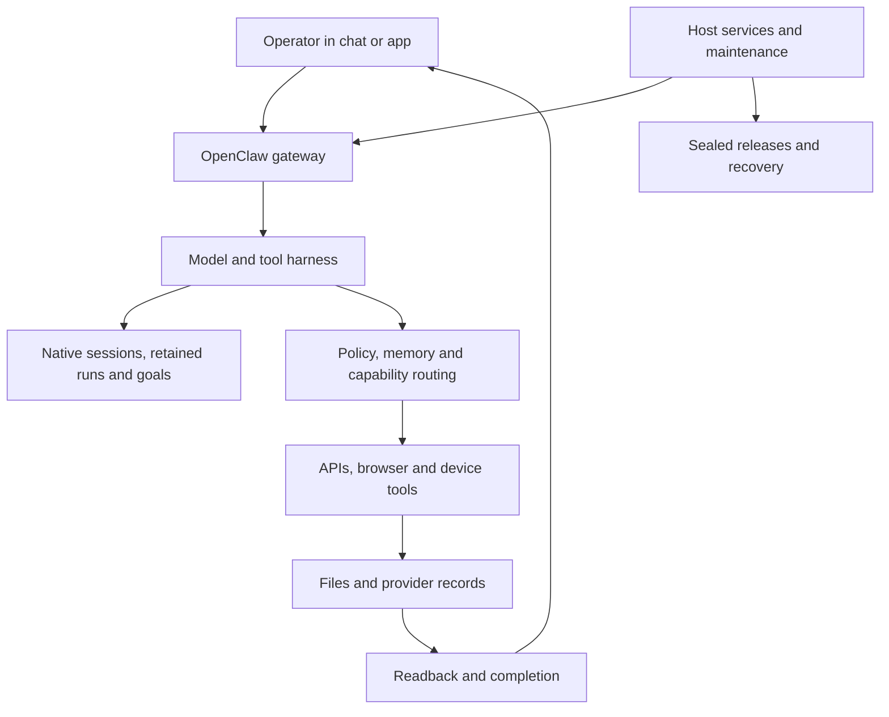

# OpenClaw Control Plane

A reproducible reference for operating a persistent **OpenClaw** assistant:
custom runtime source, agent instructions, integration routing and host helpers.
It connects ordinary chat requests to work that can continue across workers,
context changes and interruptions, then checks the result at its destination.

Use it to understand the design or build a separate installation with your own
accounts and policies. It is intended for an engineer comfortable with Git,
Python and Node.js. Host-service examples target macOS; the runtime source and
repository checks also have a Linux reconstruction path.

## How it works



| Component | Responsibility |
| --- | --- |
| Runtime | Authenticated requests, model/tool execution, delegation, continuation, text and voice delivery. |
| Workspace | Operating instructions, bounded memory, account/source routes and operational helpers. |
| Provider and device tools | Account operations, browser interaction and permitted native capabilities. |
| Host services | Maintenance, health checks and release selection outside a model turn. |
| Verification | Establishes the requested effect instead of equating an answer or build with completion. |

The [architecture](docs/04-system-architecture.md) explains these boundaries. The
[worked example](docs/07-worked-example.md) follows a calendar request from source
retrieval through destination readback.

## What is included

- **Runtime source:** a complete patch from a pinned official OpenClaw release,
  regression tests and a separately verified native distribution input.
- **Working policy:** substantial AGENTS, SOUL, USER, TOOLS and related templates
  for authorization, source selection, long tasks, writing and verification.
- **Workspace implementation:** account-aware routing, release activation,
  maintenance and recovery helpers with their contracts and tests.
- **Adoption guidance:** configuration, account enrollment, context loading,
  text/voice behavior, scheduling and installation acceptance.

Company Alpha, Company Beta and the Personal Data Project are fictional examples.
The adopter supplies accounts, credentials, paths and permissions. Exported
readiness rows start unverified; copying them does not connect an account.

## Start here

1. Read the [introduction](docs/00-start-here.md) and
   [adoption guide](docs/17-adoption-guide.md).
2. Follow [runtime reconstruction](runtime/README.md) in a clean, separate checkout
   using the exact Node.js and pnpm versions in [the manifest](runtime/manifest.json).
3. Install a new workspace, adapt the private operator configuration and enroll
   the integrations you intend to use.
4. Build and install a sealed release, then verify a small real workflow through
   your chosen interface. Add maintenance and backup schedules separately.

The manifest is the authority for the official base, current custom source,
public reconstructed tree, patch digests, toolchain and native archive. Public
reconstruction does not require a private source repository or an existing
operator's machine. Reconstruction, build, installation and actual user
acceptance are separate steps.

This reference targets the official OpenClaw **v2026.10.4** base and the
managed **Codex 0.160.0** native package. The manifest binds the complete custom source,
native distribution and companion source. The current packet reconstructs the
canonical and native distribution source; its installed R43 Mac companion build
2610000502 has a separate descriptive identity. The two test-fixture corrections
do not rebuild either installed component. Read the [current source boundaries](runtime/README.md#source-identities)
before choosing a reconstruction target. The installed-reference record does not
establish deployment or account access for a new adopter.

## Find the details

| Task | Read |
| --- | --- |
| Understand the system and terminology | [Documentation index](docs/README.md), [glossary](docs/01-glossary.md), [architecture](docs/04-system-architecture.md) |
| Adapt policy and context | [Authority](docs/05-policy-and-authority.md), [memory and context](docs/08-memory-and-context.md) |
| Connect accounts and tools | [Capability routing](docs/11-integrations-and-capability-routing.md), [configuration](config/README.md) |
| Understand long tasks and chat/voice behavior | [Continuation](docs/06-execution-and-durable-lanes.md), [delivery](docs/13-delivery-and-control-surface.md) |
| Operate releases and scheduled work | [Releases](docs/10-runtime-releases-and-promotion.md), [scheduling](docs/12-scheduling-and-background-work.md), [host operations](docs/19-host-operations-and-backups.md) |
| Inspect the runtime delta or its history | [Source map](docs/20-runtime-source-changes.md), [public history](docs/history/README.md) |

## Verify and contribute

Repository checks use Python's standard library and Node.js:

```bash
python3 scripts/validate_repo.py
python3 -m unittest discover -s tests -p 'test_*.py'
node --test tests/native-reference-checks.test.mjs
```

Run the exported Workspace behavioral fixtures separately with
`python3 workspace/tests/run_periphery_tests.py`. They use pytest and the declared
Python dependencies; [CONTRIBUTING](CONTRIBUTING.md#workspace-behavioral-fixtures)
shows an isolated environment setup. The runner supplies disposable bindings and
service/provider stubs, so private accounts and installed host services are not
test prerequisites.

These checks cover repository and helper contracts. The
[reference workflow](https://github.com/josephbergvinson/openclaw-control-plane/actions/workflows/verify-reference.yml)
also reconstructs the pinned runtime and runs its native checks and build.
Inspect results on the exact commit you adopt; an earlier green commit does not
qualify a new head. See [CONTRIBUTING](CONTRIBUTING.md).

## Scope and license

This design favors one trusted operator. Team participation and voice sessions
retain the authenticated speaker, audience and provider-role boundaries.
Accounts can expire or be revoked; recovery support is not permanent access.
A successful build does not establish account refresh, device permissions,
message delivery or recoverable backups on another host.

MIT licensed. Retain [LICENSE](LICENSE), the runtime's
[third-party notices](runtime/THIRD_PARTY_NOTICES.md) and the
[native resource notices](runtime/native160/README.md).
