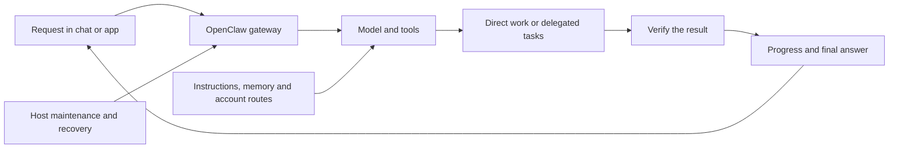

# OpenClaw Control Plane

Build a persistent OpenClaw assistant that carries work from a chat request to a
verified result. This repository combines a reconstructable custom runtime,
operating instructions, account-aware tool routing and host maintenance helpers.

It is a reference for engineers comfortable with Git, Python and Node.js.
Runtime reconstruction supports Linux and macOS; the host-service examples target
macOS. Supply your own accounts, permissions and private configuration.

## How it works



The runtime owns sessions, delegation, compaction and delivery. The workspace
supplies identity, preferences, project knowledge and operating procedures.
Tools act on the selected account; the agent reads back the result before
reporting completion. [Architecture](docs/04-system-architecture.md) explains the
boundaries, and the [calendar example](docs/07-worked-example.md) follows one task.

## Start here

| Your goal | Read |
| --- | --- |
| Understand the design in a few minutes | [Introduction](docs/00-start-here.md) and [architecture](docs/04-system-architecture.md) |
| Build your own installation | [Adoption guide](docs/17-adoption-guide.md) and [runtime reconstruction](runtime/README.md) |
| Adapt instructions, memory and account routing | [Policy](docs/05-policy-and-authority.md), [context](docs/08-memory-and-context.md) and [integrations](docs/11-integrations-and-capability-routing.md) |
| Operate long tasks, voice and scheduled work | [Continuation](docs/06-execution-and-durable-lanes.md), [delivery](docs/13-delivery-and-control-surface.md) and [scheduling](docs/12-scheduling-and-background-work.md) |
| Review measured results and possible improvements | [Evaluation and future work](docs/22-evaluation-and-future-work.md) |
| Find a specific component or procedure | [Documentation index](docs/README.md) and [runtime source map](docs/20-runtime-source-changes.md) |

## What you can reproduce

- **Runtime:** a complete patch from official OpenClaw **v2026.10.4**, regression
  tests and the managed **Codex 0.160.0** native package.
- **Workspace:** operating instructions, source/account routing, release
  activation, maintenance and recovery helpers.
- **Integration patterns:** configuration and fictional company examples for
  connecting your own services and devices.
- **Operating workflow:** build, install, verify and recover a selected release.

The [manifest](runtime/manifest.json) pins source, patches, toolchain and native
artifacts. The optional Mac companion has its own source target; its local Bun
security payload is outside this reconstruction package. See
[source identities](runtime/README.md#source-identities) for the exact boundaries.

Company Alpha, Company Beta and the Personal Data Project are fictional. Example
readiness records start unverified. Enrollment and a real workflow check complete
an installation.

## Results and direction

The reference includes tested improvements to compaction, usage accounting,
browser ownership and task delivery. Its bounded comparison found similar task
quality on most qualified pairs, while native Codex usually finished faster.
[Results and lessons](docs/22-evaluation-and-future-work.md#measured-results)
explain the measurements and the next experiments: simpler execution, focused
context and fewer unnecessary model calls.

## Verify and contribute

```bash
python3 scripts/validate_repo.py
python3 -m unittest discover -s tests -p 'test_*.py'
node --test tests/native-reference-checks.test.mjs
```

[CONTRIBUTING](CONTRIBUTING.md) covers workspace fixtures, runtime checks,
confidentiality review and publication. The
[reference workflow](https://github.com/josephbergvinson/openclaw-control-plane/actions/workflows/verify-reference.yml)
reconstructs and builds the pinned runtime. Use the checks attached to the commit
you adopt, then verify your installation through an ordinary task.

Designed for one trusted operator, with explicit audience and account boundaries
for shared conversations. See the [security model](docs/16-security-and-trust-model.md).
MIT licensed; retain [LICENSE](LICENSE), [runtime notices](runtime/THIRD_PARTY_NOTICES.md)
and [native resource notices](runtime/native160/README.md).
