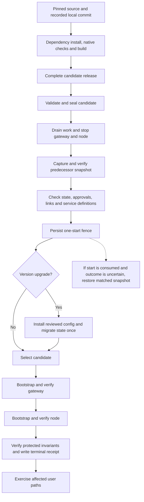
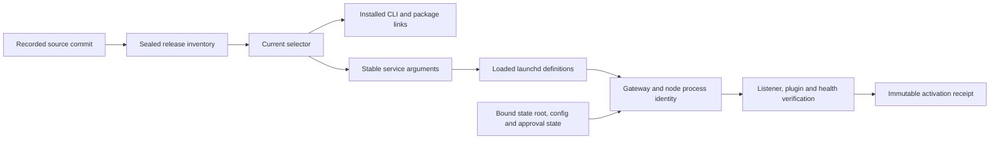

# Runtime releases and promotion

A release is a built, checked copy of runtime source. Activation makes that copy the
selected runtime and verifies the processes that actually started. The source checkout,
release, selected path, loaded service definition and running process are separate
identities. The current design checks each one.

The reference uses a single activation owner, `openclaw_runtime_activate.py`. It seals
candidates, captures a stopped predecessor, activates once and preserves a matching
recovery path. The earlier workspace phase-plan machinery has been retired. Native
OpenClaw retained-run, harness and state mechanisms remain the execution authority.

The managed Codex package is a reviewed dependency of the sealed runtime. Its
native homes and stores, and the matching companion, belong in the affected
installation's recovery inventory. Native store initialization remains with its
existing owner. Updates use the same sealed-release activation procedure;
a competing package updater must not replace components alongside it.

## From source to candidate

Reconstruct the pinned source using [the runtime package](../runtime/README.md). Record
the public tree under the adopter's own commit, install the pinned dependencies, run
the applicable native checks and build. The build must contain the required runtime
entrypoints, bundled plugins and a dependency closure that does not point back into a
disposable worktree or shared mutable store.

Build output is not automatically a release. Copy the complete validated closure into
a new release directory, inspect its file modes and symlink targets, and seal that
candidate. A seal binds the source commit, release identity and normalized inventory.
Keep the previous selected release and its compatible state available until recovery
and acceptance obligations are satisfied.

The [standalone promotion diagram](../diagrams/runtime-promotion.mmd) uses the same sequence.
The activation helper is designed for an already qualified predecessor installation.
The [first-install sequence](17-adoption-guide.md#6-establish-the-first-installed-runtime)
packages and seals the initial build, stages disabled service definitions, creates the
exact selector/support links, installs the reviewed definitions and starts each
service once. Actual process and user-path checks establish that predecessor. It
does not invent historical state or an activation receipt for first installation.

## What must agree before activation

The helper checks the candidate seal, expected source commit and stopped snapshot. It
requires the gateway and node to be stopped, the current selector still to name the
captured predecessor, and the support links and service definitions to match their
recorded bindings. Runtime state, configuration and native execution approval records
have their own checks.

Provider authentication is persisted native state. The activator checks the expected
profile-order count and digest and the usability of that order; these are
**adopter-derived inputs**. Copying another operator's values would reject the adopter's
valid accounts or falsely imply account equivalence. Secret token values do not belong
in an activation receipt or public configuration.

A same-version change preserves the protected runtime configuration and uses the same
state root. A version upgrade additionally binds an explicitly reviewed configuration
and invokes the candidate's native Doctor migration once. The helper uses the
declared worker/SDK entrypoints and the native protected result-file contract;
successful process exit alone is insufficient. Advisory results and native
maintenance/config-write refusals remain failures. After migration it rechecks the
protected state, service definitions and semantic approval/authentication bindings.
The migration path is not a license to rewrite unrelated account state.

## One start and an inspectable outcome

The helper takes an exclusive operation lock. Before applying the change it writes an
immutable start-consumption record bound to the candidate seal and snapshot. It then
moves the current selector, bootstraps the gateway once, verifies it, bootstraps the
node once and verifies it. It checks the protected invariants again before recording
`activated`.

These are meaningful failure distinctions:

| Outcome | Meaning | Next step |
|---|---|---|
| `failed_before_apply` | Preflight rejected the operation before consuming the start fence. | Inspect and correct the actual precondition, then create a reviewed attempt. |
| `activated` | The bound activation and its process/invariant checks succeeded. | Verify the affected channel, tool or device behavior. |
| `snapshot_restore_required` | The one-start attempt was consumed, failed or has an ambiguous interrupted outcome. | Inspect the retained evidence and use the matched restoration procedure. |

Repeating the exact successful operation verifies its persisted bindings before
returning the existing result. Finding a consumed start fence does not permit another
blind bootstrap. A failed attempt and its evidence remain available; a later passing
check does not rewrite that history.

## Running identity and state

The [identity diagram](../diagrams/identity-convergence.mmd) separates persisted and
running identities. A correct symlink alone does not prove which process owns the
listener. A healthy gateway alone does not prove the node loaded the same release.

## Recovery and retention

Recovery couples a release with its matching state and service definitions. Selecting
old code against migrated current state is not an established rollback. The stopped
snapshot includes the protected runtime state, gateway and node definitions and
selector, with checked archive members and metadata. Its explicit recovery-root
inventory also covers actual external agent/plugin/config data, native rollout
history, the real native home and any separate SQLite home, all seven database
families and the matching companion. Derive this inventory from effective config
and native environment rather than inventing default paths. Roots inside captured
state and nested external roots are normalized under the existing snapshot owner.

Settle the affected native writers and preserve their admission/lease fences before
capture or restore. Open-file checks supplement that custody; they cannot prevent
a running writer from opening a file after inspection. Copied-state migration and
a matched whole-generation restore rehearsal qualify the transition separately
from source tests. Do not run the native updater or a second snapshot/migration
engine alongside the activator.

Use the helper's `restore` procedure against the exact failed activation bindings.
Restoring after a successful activation is a distinct explicit mode because effects
may have occurred after startup. Never delete the result or start fence merely to
make another attempt fit the same namespace.

Completed activation history survives an APFS remount through stable volume UUID
and inode bindings. The original device number remains a historical observation.
For an older terminal record without a UUID, a changed device number is admitted
only by this locked retirement owner after verifying the registered data volume,
the same physical read-only release inode, its full sealed content inventory,
candidate seal and snapshot provenance. Original result, fence, seal and snapshot
bytes are preserved. New retirement receipts carry the stable bindings used by
the existing ScreenCapture-history and release-retention readers. Unverifiable
legacy archive history stays ineligible; it does not grant deletion authority.
This does not requalify a capture process or make an old seal, stopped snapshot,
bootstrap or process identity usable for a new lifecycle operation. Those checks
still require their exact current-incarnation identities and fresh stopped state.

Release and promotion retention preserve selected releases, rollback references,
active operations and unknown layouts. Their dry-run reports must be read before
applying a deletion. Unknown ownership means preserve until resolved.

## What activation proves

For the Journal capture route, the configured activation guard preserves the
responsible executable identity and checks its exact TCC ScreenCapture grant,
including the stored code requirement. A stable grant is only a prerequisite.
Current capture readiness additionally requires fresh evidence from the actual
scheduler, Python and Peekaboo route; a process or activation change invalidates
the earlier behavioral evidence. The [manual acceptance procedure](../workspace/runbooks/runtime-activation.md#journal-capture-acceptance-and-permission-continuity)
provides that refresh without exporting, ingesting or replaying Journal data.
Scheduled synchronization remains a separate acceptance claim.

After a checked rollback, fresh capture acceptance can use the existing successful
`restored` receipt. The shared resolver binds it to the exact failed activation,
start fence, selected predecessor and current gateway process; a stopped or
incomplete restore cannot qualify. The failed activation remains intact. Native
terminal-receipt retirement preserves an established binding only through the
latest matching immutable receipt set, without extending it to a later process.

A successful activation receipt proves the checks represented in that receipt. It
does not establish every user workflow. After changes to delivery, run a real channel
request and inspect the visible message. After account changes, check the intended
identity and refresh path. After device changes, verify the actual device operation.
After backup changes, retain an independent restoration receipt.

These distinctions make upgrades slower than replacing a package directory. They also
make a failure explainable and recovery specific. See [evidence and verification](15-evidence-audit-and-verification.md)
and [host operations](19-host-operations-and-backups.md).

### Explicit Node security transition

The same activation owner can bind a reviewed Node executable transition to its
ordinary release activation. A schema5 stopped snapshot then contains eight base
controls: runtime state, both service plists, the release selector, the existing
managed Node selector, the two known compatibility aliases and the shell CLI
wrapper. Configured external recovery roots are added to that inventory without
changing their ownership or purpose. Ordinary activation retains its four base
controls. This is one activation and one start fence.

The transition declaration pins both executable hashes, exact predecessor alias
targets, the wrapper byte/mode identities and a separate candidate ScreenCapture
precondition. Candidate paths derive from the existing managed selector. Only the
wrapper's Node exec prefix changes; unrelated PATH entries retain their order and
duplicates. The exact retired managed22.22 path is normalized to that selector.
The matching snapshot restores original bytes and alias targets after a partial
failure; a consumed or ambiguous start restores stopped state.

The precondition proves candidate code identity and its recorded permission only.
It never proves effective capture. Fresh capture, visual acceptance and enrollment
under the actually running candidate remain separate post-activation gates. Keep
those receipts, grant details and operator paths private. Configure any non-default
managed executable code hashes in `runtime.managed_node_executable_sha256` using
version-directory names and lowercase SHA-256 values; missing or mismatched code
never obtains activation authority. Official macOS binary pins are the defaults.

For the current macOS reference, ordinary helper lookup also verifies the two
compatibility aliases at `<host_home>/.local/bin/node` and
`<host_home>/.local/opt/node-current`, plus the executable shell CLI wrapper at
`<host_home>/.local/bin/openclaw`. Provision these known roles with owned physical
parents before using the helper; the aliases may already point through the sole
canonical Node selector. Their existence is a setup prerequisite, not permission
to invent arbitrary paths or to create a second selector. Unchanged compatibility
roles do not add snapshot members during an ordinary four-control activation.

### Candidate access and capture-binding refresh

A new managed Node toolchain needs a schema-v2 precondition that verifies its recorded ScreenCapture and Full Disk Access grants against the exact executable and compiled code requirement. Run the existing `node-toolchain-preflight` before stopping the predecessor; activation checks the grant again before first boot. Recorded grants do not prove effective filesystem access or screen capture. Historical v1 receipts remain readable for recovery, and an ordinary release using the selected Node has no new candidate-grant requirement.

After activation, use the existing private Journal capture and visual-acceptance route. Enrollment remains create-only unless `screen-capture-enroll` receives both `--replace-binding-sha256` and `--replaced-binding-archive` for the configured canonical binding. The explicit refresh takes the existing activation lock, preserves exact predecessor bytes in a new immutable private archive, rechecks current process, code, grant and activation evidence, and atomically publishes the successor. Capture receipts and permission data belong in the adopter's private evidence directory; keep them out of this repository.
