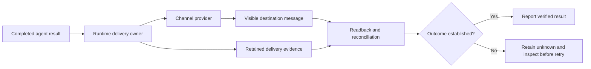

# Delivery and the operator interface

Discord and Telegram are interfaces for directing work, receiving progress and
reviewing results. The answer should satisfy the request in ordinary language;
the runtime records establish what executed and whether delivery succeeded.

## Separate three events

| Event | What it proves | What it does not prove |
| --- | --- | --- |
| Model response completes | The provider returned that response. | The requested task finished or the destination received it. |
| Task or goal completes | Its owner recorded a terminal outcome. | A visible message or external write exists at the intended destination. |
| Destination readback confirms an effect | The particular message, event or file is observable there. | Every other part of the workflow is correct. |

A transcript may contain generated responses and delivery mirrors. Count actual
destination messages when checking duplicates, and inspect the intended account,
channel and thread when checking a missing final.

## One clear result

The parent responsible for the request owns its visible result. A worker returns
evidence to that parent unless a supported route assigns delivery elsewhere.
Direct replies, commands and resumed child results must preserve the same native
completion ownership. A later worker event should not repeat a delivered final.

For multi-part text or attachments, preserve all requested content and verify the
delivered artifact. A committed patch, prepared message or local report does not
finish a request that also authorized release or delivery. Continue until the
requested effect is verified or an actual dependency prevents further progress.

The default reply mode may supply the originating message reference when a tool
caller omits it. That convenience does not change the destination or grant a worker
new posting authority. Explicit account, channel and thread bindings still apply.

Use useful prose, without routing dumps, redundant terminal notices or internal
inspection vocabulary. Explain a limitation by its effect on the request.

## Progress should reduce uncertainty

During substantial work, provide material milestones and explain a real dependency
promptly. Say what is established and what the next step will resolve. Repeatedly
editing an old message may be insufficient during a long wait; use the supported
visible progress path. Policy sets the expected cadence, while runtime presentation
and native task ownership keep continuation updates deliverable.

`channels.discord.streaming.progress.narration: false` omits generic tool-status
narration. Keep authored `commentary` enabled when wanted; `toolProgress` controls
tool progress separately. The editable progress card uses `streaming.mode:
"progress"`. These settings change presentation, not execution or final ownership.

A legitimate yield is not an empty failed answer. Retain the original objective,
child/result owner and requester return path, and resume when the child returns.

## Company reply surfaces

A registered read source can also be an approved reply surface. Registering the
source alone does not create inbound routing or a standing posting grant. Bind the
intended agent, account, guild/channel, sender/mention behavior and company policy.
Verify effective View Channel, Send Messages and applicable thread permissions;
category/member overrides can still reject a correctly routed send.

Test an ordinary permitted mention in the intended channel. A configuration
readback or a reply elsewhere does not establish this route. The provider's actual
roles apply; “full access” should not be interpreted as authority the operator lacks.

## Realtime voice and task handoff

Voice uses the authenticated speaker, their selected agent and the room's policy.
Bind the operator's real identity separately from display aliases. Configure the
voice provider/model, preferred voice and speaking instructions, wake names and
room/guild overrides through the native schema. Text-channel admission alone does
not enable voice; verify voice-state access and actual Connect/Speak permissions.

Selected profile and policy context enters a new voice session at startup. The
owner's permitted primary context and room context may both be supplied. Guests
receive only their applicable context. Changing a file does not rewrite a running
voice session; reconnect or use the supported session refresh before accepting the
change. Inspect actual context/loading diagnostics instead of asking the model to
infer whether a file was loaded.

Configure `voice.actionHandoff` for rooms that should execute tasks. The realtime
speaker can acknowledge a request and consult the normal agent for relevant records,
delegation or actions. Conversation-only settings should not be presented as a
missing capability. Authorized work retains its original requester and destination;
the assistant follows up with the verified result rather than only promising work.

Playback queueing, interruption preferences and provider recovery have independent
owners. A generated reply is not proof that the full audio played. Measure first
response delay and full audible completion on a real call; a test count or preferred
voice setting cannot establish latency or a consistent accent by itself.

## Meeting capture and minutes

Use a requested or standing authorized recording preference and make participants
aware that notes are being captured. Resolve “join me” with the authenticated
requester's native voice-status result and verify the room. Ask for a room only
when that result leaves a material ambiguity.

Two supported workflows have different lifecycle owners:

| Workflow | Lifecycle |
| --- | --- |
| Configured participant following/meeting recording | The follow owner tracks the visit, recording, finalization and configured summary destination. Explicit leave pauses following for that visit; a new visit is a separate event. |
| Manual `transcripts` capture with `discord-voice` | Retain the exact returned selector, stop that capture explicitly, wait for finalization and inspect/deliver its notes. Do not assume it automatically posts or detects the meeting end. |

Native `message` action `voice-join` is connection-only; it does not by itself start
a manual transcript. Use `voice-status`, `voice-join` and `voice-leave` through the
authenticated requesting agent. A background drafting worker does not inherit live
meeting-control authority merely because it received a transcript.

Captures can include human speech and assistant speech that actually reached
playback. Outgoing audio enters the recorder separately from conversational input,
so it cannot make the bot hear and answer itself. Stop/leave finalization drains
accepted input/output for that capture; a late old response must not enter a new
meeting. Interrupted, unheard or uncaptured content remains a coverage limitation.

Use the LLM to draft decisions, action owners, stated deadlines and open questions.
Check names and facts against relevant existing records; do not turn a transcription
mistake into an invented company or decision. Preserve uncertainty and meaningful
coverage gaps. Avoid a second elaborate correction system when contextual review
is sufficient.

When leaving, finalize and deliver the task's active capture before closing any
remaining owned connection. A capture attached to an existing conversation must
not disconnect that other owner. Do not install a recurring recorder for one
requested meeting or broaden recording to unrelated rooms.

## Context notices and interrupted requests

Supported compaction preserves task continuity but is separate from the next model
request. If a provider request fails after compaction, retain the original task and
use supported bounded recovery; do not claim the task finished or require a new
conversation when normal continuation can recover it.

Background maintenance and manual compaction can have different notice paths.
Test the actual foreground owner instead of adding a parallel warning monitor.
A checkpoint, typing indicator or retained child is not a substitute for useful
progress and a final answer.

## Ambiguous delivery

Inspect the provider destination, native delivery owner and retained evidence before
retrying an uncertain send. A stale transcript mirror or missing optional diagnostic
record proves neither success nor failure. Keep account/thread bindings intact and
retain an unknown outcome if the provider result cannot be established.

Internal deduplication reduces repeated sends; it is not an unconditional exactly-once
promise across every provider failure. The [standalone diagram](../diagrams/delivery-path.mmd)
shows the same verification boundary.

## Acceptance through the real interface

Use a natural text request to check context, progress, worker continuation and a
single visible final. Compare attachments with the intended bytes/content. In voice,
verify identity/context in a new session, a complete audible reply, permitted task
handoff and return of the result. Finish a short capture and check both sides of the
saved transcript and its delivered minutes. Exercise relevant interruption cases
separately; one successful call is not proof for every room, account or future run.

The [worked example](07-worked-example.md) demonstrates the user-facing contract;
the [source map](20-runtime-source-changes.md) locates its runtime mechanisms.
