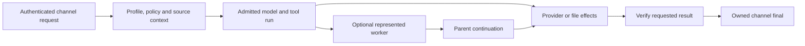

# Runtime source map

The public package contains the complete delta from the official source selected
by [the manifest](../runtime/manifest.json). This chapter maps its mechanisms to
source areas in the reconstructed checkout; it is not an exhaustive changed-file
inventory or a deployment diary. Use Git to inspect the exact patch and regression
tests. [Reconstruction](../runtime/README.md) checks the resulting tree and modes.

## Follow one request

Policy describes the intended behavior. Runtime source binds the requester,
execution, continuation and delivery. Workspace helpers own their checked
operations. No one layer substitutes for the others.

## Requests, tools and durable work

| Mechanism | Implementation area and behavior |
| --- | --- |
| Request admission | `src/auto-reply/reply` and channel ingress retain authenticated source/account/session context. Fetched text, a quoted message and a worker result do not create new requester authority. |
| Tool access | `src/agents` and gateway tool resolution carry the admitted permission mode and tool policy into execution. Authenticated-owner defaults do not become permissions for unrelated senders. |
| Visible workers | Native session/subagent tools and the retained run registry represent delegated work and bind registered projects to their authorized source root/worktree. The caller supplies the task scope; workers retain its constraints. |
| Native goals | Goal/run accounting preserves the objective, accepted usage and terminal state across attempts. A model response ending does not itself satisfy the goal. |
| Yield and continuation | Native requester continuation, reply dispatch and harness custody preserve the return route while a child runs. A successful explicit yield with accepted completion children retains its requester handoff through internal prompt cleanup. The existing dispatcher can transfer an already confirmed current progress card without a new payload; recovered prepared cohorts retain its progress reference. Cancellation, failure and completed-output checks still apply. For an otherwise-silent explicit yield, the LLM-authored `acknowledgment` gives visible verified progress, the current wait and next step; `message` stays private continuation context. Missing acknowledgment can still use the generic waiting fallback. |
| Original task context | Session creation, continuation and scheduled recovery retain the original request and source bindings. Later steering can correct ongoing work without silently replacing its objective. |
| Follow-up admission | Queue and steering owners distinguish live corrections, queued follow-ups and independent requests. Ownership is rechecked after preparation and replacement; a stale parent or source cannot adopt another run. |
| Admitted requester scope | Same-child follow-up execution and its completion record retain the admitted requester, account and channel partition through existing private in-process metadata. Target incarnation and source custody remain binding; later sender context does not silently replace the admitted scope. Finite mismatch diagnostics name the comparison stage and differing fields without exposing identity values. |
| Child completion | Registry, announcement and requester-continuation paths keep result delivery owned through settlement and cleanup. Gateway start notification waits for both runner entry and live admission. Its deferred observers inherit the owning execution context rather than a shorter model-attempt scope, so normal model completion does not cancel a still-authorized final handoff. Source revocation and cancellation checks remain binding. A late completion does not justify another copy of an already delivered final. |
| Deadlines and cancellation | Spawn, backend and native process boundaries carry configured deadlines, including explicit zero where supported. Stale-session recovery honors a current native invocation's accepted deadline-free lifetime, then allows bounded collection from its confirmed normal exit. Orphaned markers, cancellation and expired deadlines remain recoverable. Observation timeouts, execution deadlines and caller cancellation keep separate meanings. |
| Interrupted work | Durable run/session state and current execution handles inform recovery. Inspect effects before retrying; losing a wait or shortening a transcript does not prove an action never occurred. |

See [continuation](06-execution-and-durable-lanes.md) and
[authority](05-policy-and-authority.md) for the working contract.

## Context, memory and model requests

| Mechanism | Implementation area and behavior |
| --- | --- |
| Bootstrap selection | `src/agents/workspace.ts` owns recognized filenames, guarded reads and role/session filtering. Workspace manifests describe intended context but do not inject arbitrary files. |
| Durable context | Primary and company profiles carry stable identity, preferences and source pointers. Retrieval remains source- and audience-aware; stale memory cannot prove current provider facts. |
| Compaction | Native context-pressure handling, summary construction and memory flushing retain recent task context and writer custody. Same-request retries carry earlier confirmed delivery facts forward once; progress does not settle an owed child final. Genuine lifecycle updates use the existing presenter, including the same status card when that mode is enabled; successful compaction remains distinct from a later model-request failure. |
| Optional recall | Memory preparation and search have bounded scope and usable fallbacks. Unavailable semantic search does not disable exact source lookup or justify claiming all context is missing. |
| OAuth refresh | `src/agents/auth-profiles` retains refresh ownership and durable profile adoption under queue/cross-process locking. A caller timing out does not authorize a competing refresh or identity substitution. |
| Request accounting | Transport metadata and accepted response identities distinguish configured model/reasoning preferences, outgoing requests, returned usage and goal totals. They do not expose hidden reasoning. |
| SDK and plugin contracts | Compiled SDK surfaces, generated schemas and plugin metadata travel with their consumers and tests. A source export must include the dependency closure rather than a few hand-selected fixes. |

[Memory and context](08-memory-and-context.md) explains loading boundaries and
[configuration](../config/README.md) describes the adopter's settings.

## Text, voice and meeting records

| Mechanism | Implementation area and behavior |
| --- | --- |
| Channel routing | Discord/Telegram adapters preserve the intended account, channel and thread. Exact-message reads return that message or an error instead of substituting general history. |
| Progress | When status-card progress is enabled, reply presentation updates the current card across long work and legitimate yields, preserving authored milestones; final delivery is a separate message. Confirmed card identity survives the existing durable handoff and restart recovery, so a final edit cannot turn that card into the completed answer. Legacy records without confirmed identity remain unknown. Other modes retain their configured behavior. For quiet progress cards, internal file-change counters remain structured state rather than visible status text. Optional tool narration is distinct from useful commentary. |
| Final ownership | Direct replies, command settlement, workers and resumed runs share native delivery ownership. Implicit reply references follow the configured route while explicit targets and source checks remain binding. A settled successful explicit final edit of an existing completed answer at the exact current source records completion through the per-tool terminal hook, including nested message actions. Wrong targets, dry runs, partial delivery and failed edits do not suppress the separate final. Required terminal saves remain joined; a later cleanup failure cannot replace the original execution error or reclassify cancellation. |
| Delivery reconciliation | A model result, internal terminal record and provider-visible message are distinct observations. Unknown sends require inspection before retry; an unconditional exactly-once guarantee is not implied. |
| Voice identity and context | `extensions/discord/src/voice` resolves the authenticated speaker and whole selected primary/room policy and profile before admitting speech. Explicitly selected owner records retain required-file checks and native memory audience filtering; guests retain room context without the owner's private additions. |
| Wake name and task handoff | Room/guild voice settings control when the bot responds and whether it may consult the normal agent for records or actions. A spoken acknowledgment and eventual result keep the original request's owner. Same-room follow requests reuse the pending join and voice generation; late agent consults obtain fresh admission through the existing Gateway work owner, retaining caller, room and cancellation checks. |
| Playback and interruptions | Realtime and speech pipelines retain queued replies, PCM/playback ownership and configured interruption behavior. Room/provider replacement cannot reopen stale playback or reconnect indefinitely after a terminal error. |
| Two-sided recording | Assistant audio enters the meeting recorder through played output, separately from conversational ingress. Generated but unheard text is not recorded as speech, and the bot does not respond to its own recording. |
| Capture finalization | Recorder drains and lifecycle ownership keep pending speech/output associated with the right capture through stop/leave. Summary and destination delivery follow the configured capture/follow owner. |
| Minutes quality | Periodic and final LLM summaries retain the admitted plugin's model and record-check context across timer and late provider callbacks. Minutes use relevant authoritative names/facts while preserving the raw transcript, uncertainty and coverage gaps; they must not invent content. |

[Delivery and voice](13-delivery-and-control-surface.md) connects these mechanisms
to configuration and real-interface acceptance. Test fixtures establish their
specified scenarios; listening to a real call and reading its saved record are
separate checks.

## Native application and browser interaction

The Mac companion and bundled worker retain explicit source and build identities.
The companion may use the native distribution's exact source identity or one of
the [declared finite deltas](21-native-runtime-reconstruction.md#optional-companion-source).
A descriptive installed companion identity is also permitted; it grants no
reconstruction target without a supported binding. The current packet retains
Mac companion build 2610000502 in that descriptive case. Canonical/native source
includes OAuth bearer, loaded-profile recall and successful yield handoff repairs.
Its retained embedded JavaScript is distinct from the selected external gateway
source; see the [source boundaries](../runtime/README.md#source-identities). Every
supported reconstruction requires a full
target-tree check. Source reconstruction does not install or launch the app.

Local application authentication resolves the configured gateway SecretRef through
the matching native helper, using bounded private pipes and current configuration.
Automatic local-mode cleanup preserves a node explicitly configured as externally
owned; manual stop remains available. A terminal's inherited environment is not
a substitute for the Finder-launched application's actual authentication path.

Browser and Computer tools are complementary. Use the supported browser interface
for structured page operations and direct Computer interaction for native prompts
or workflows whose normal interface needs it. The requested account and provider
rules remain the same whichever route performs the action. A denied OS permission
should identify the observed capability; it does not prove the whole app or account
is inaccessible. Computer RPC deadlines follow the action budget while preserving
explicit shorter timeout caps.

Opaque credential bindings identify an existing protected consumer. They support
secret entry without placing password values in prompts, logs or shell arguments.
Native authentication, autofill and recovery remain separate from the provider's
current account authorization. Bounded diagnostics and cleanup must retain the
original failure and close only resources owned by that operation.

Source areas include `apps/macos`, `src/node-host`, browser plugin interaction and
credential consumers, and the native worker's tool lifecycle. The
[security chapter](16-security-and-trust-model.md) describes the boundaries.
The [native packet](../runtime/native160/README.md) identifies the separately
published dependency, source patch and resource notices.

## Scheduling, releases and host helpers

| Owner | Contract |
| --- | --- |
| Native cron | A persisted definition binds schedule, command/model settings, tools, deadline and delivery. Run results keep their admitted configuration identity; later edits do not rewrite history. Public job projection omits known unsupported diagnostic fields from response copies while preserving stored records and the canonical schema. |
| Command supervision | Python entrypoint receipts distinguish child exit, termination and residual processes. Native exit success alone does not prove the command's domain effect or provider delivery. |
| Toolchain and cold wrappers | `scripts/install-cli.sh` selects the requested versioned Node directory; an older prefix does not satisfy a different requested default. The trusted PR wrapper uses its existing inventory for transitive startup and selected worker-runtime imports during cold extraction. |
| Existing recovery | A configured repair retains the original deadline and independently verifies the repaired operation. Agent prose is not the verification command. |
| Release activation | The host's activation owner seals a complete candidate, captures compatible recovery state, admits one start and retains its authentic initial-generation verification. Source publication can bind that accepted result; reconciliation alone is not activation or a fresh observation of a running process. |
| Host lifecycle controls | Prefer native controls. When they lack the required host operation, an authenticated owner's explicit or standing authorization permits the existing documented external lifecycle route, with normal exec authorization, drain/handoff, resumable-work and rollback checks. Respect policy refusals and reconcile admitted updates before another transition. A setup reply is guidance, not evidence of execution. |
| Health and access | Existing health owners check their declared runtime and provisioned account routes. Normal provider refresh and task-time recovery retain exact identity; missing optional bindings do not fail unrelated accounts. |
| Maintenance and recovery | Classified cleanup, retention and backup helpers keep producer/lease, identity and recovery checks. They must report partial work honestly and preserve unknown or active data. |

The runtime patch and exported Workspace are different source owners. A host may
retain its private activation/publication owner rather than export that operator's
implementation or receipts. An adopter must supply and verify their own release
transition; the public manifest is not an activation service. See
[scheduling](12-scheduling-and-background-work.md),
[release promotion](10-runtime-releases-and-promotion.md) and
[host operations](19-host-operations-and-backups.md) for their procedures.

## Reproduction and qualification

The complete patch retains source, regression tests, SDK/schema changes and
required dependency metadata. Deliberate public fixture normalization is declared
in the manifest; it cannot hide a production difference. Current source and
optional native distribution trees are separately bound and checked.

Use the public [reconstruction procedure](../runtime/README.md), then inspect
[hosted checks](https://github.com/josephbergvinson/openclaw-control-plane/actions)
for the exact commit. Source equality, tests, build, activation and user-visible
behavior establish different claims. An adopter supplies their own model,
accounts, device permissions, schedules and acceptance checks.

## Attribution

Retain OpenClaw's [license](../runtime/LICENSE),
[third-party notices](../runtime/THIRD_PARTY_NOTICES.md) and the
[native resource notices](../runtime/native160/README.md). A consolidated patch
preserves the complete source delta without publishing the originating operator's
private Git history, configuration or operational records.
