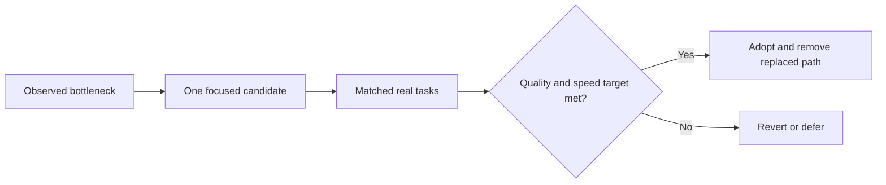

# Evaluation and future work

The control plane should help an assistant finish useful work with less
supervision. The next gains should come from simpler execution, better use of
context and shorter waits. This chapter separates measured results, engineering
lessons and proposed experiments.

## Measured results

The November 2026 evaluation compared a frozen custom OpenClaw baseline, a frozen
candidate and native Codex. It covered code/tool use, long-context continuation
and browser workflows. All 72 planned positions have an outcome: 68 admitted runs
reached a terminal disposition and four stopped at prerequisites before task input.
A terminal disposition includes failures; it is not a task-success count.

The baseline was an earlier **custom installation**, not stock OpenClaw. Fifteen
cases qualified for a three-way comparison. Against that baseline, the candidate
had 13 quality ties, one win and one loss. The win concerned labels and completed
effects; the loss concerned cleanup of an owned blank browser tab.

Seventeen candidate/Codex pairs qualified for a quality comparison. Sixteen scored
100/100 for both; the remaining pair scored 75 for the candidate and 100 for Codex.
Codex finished faster on 16 of the 17 pairs. Configuration and observation groups
are kept separate:

| Group | Qualified pairs | Mean task quality: candidate / Codex | Median completion time: candidate / Codex |
| --- | ---: | ---: | ---: |
| Original configuration and observer | 9 | 100 / 100 | 199.5s / 122.6s |
| Updated configuration, original observer | 1 | 100 / 100 | 76.8s / 71.2s |
| Updated configuration and bounded observer | 7 | 96.4 / 100 | 341.1s / 153.8s |

The combined acceptance target was **not met**. These are small, selected,
task-specific samples, not general intelligence scores. Later runtime repairs
retain their own checks; they do not change the frozen comparison. Raw traces and
account-bearing evidence remain private. The task suite and scoring rubrics are
not published in this repository; these are reported evaluation results, not a
publicly rerunnable benchmark. This round did not compare stock OpenClaw
or rerun Hermes, so it supplies no current ranking against either.

Separate compaction development checks preserved required state in eight cases per
arm. Summary calls fell from 16 to eight, summary time by 33.76% and provider tokens
by 18.07%. Those are gains in the compaction step, not whole-task speedups.

Fresh deployed checks subsequently demonstrated browser reuse, task-tab cleanup,
one final answer and correct incorporation of a user correction. The browser task
took 68.5s to its first useful finding and 78.3s to its final text. The delegated
correction task took 492.2s to final delivery. Its correction arrived before the
child finished, but the observer missed the exact native admission boundary, so
strict live-correction timing remains unqualified.

## What we learned

| Finding | Engineering lesson |
| --- | --- |
| The production tool interface differed from the interface used in a motivating benchmark. | Trace the actual deployed call path before changing an interface. |
| Split-turn compaction summarized the same prefix twice. | Remove duplicated work at its existing owner before adding a new memory layer. |
| A confirmed answer lost its delivery record when history was mirrored. | Preserve trusted effect identity through recovery; text similarity cannot establish delivery. |
| Browser guidance conflicted about reuse and profile selection. | Give the model one clear tool contract and keep tab ownership in the existing lifecycle. |
| Some long delays contained very little tool-execution time. | Measure provider generation, preparation, queueing, compaction and tool time separately. |
| Observer timing and prompt/oracle disagreement affected acceptance. | Qualify the measurement route first and preserve setup failures in the results. |
| Successful local repairs did not establish an aggregate speed advantage. | Evaluate the user outcome, including waits, interventions and cleanup. |

Implemented mechanisms are mapped in the [runtime source chapter](20-runtime-source-changes.md).
The lessons below guide future choices; they introduce no new runtime component.

## Proposed next experiments

### 1. Simplify the execution engine

Evaluate using a maintained native execution harness behind the existing
OpenClaw gateway and control plane. Keep the useful identity, account/project
knowledge, tools and delivery interface. Replace a duplicated execution path
where the candidate can own the full task lifecycle.

The central question is whether this reduces model/tool translation and repeated
coordination while preserving corrections, children, cancellation, authenticated
scope and final delivery. Adding an agent inside another competing agent loop
would defeat the purpose.

### 2. Match reasoning effort to the task

Compare a lower-effort path for routine retrieval, navigation and short edits
with the current high-effort configuration. Retain the strong reasoning path for
ambiguous planning and difficult engineering. Make selection observable and
preserve explicit operator choices. Adopt this only if completed-work quality
holds while response and completion times improve.

### 3. Keep context useful and tools direct

Retain concise identity, preferences and source pointers. Retrieve relevant
project facts when needed. Remove repeated instructions, stale procedure copies
and model calls that only rediscover information already available in trusted
context. Favor direct supported tool operations; use the existing browser session
and lifecycle when visual interaction is needed.

### 4. Treat completion and cleanup as part of capability

Keep one task owner through corrections, compaction and delegated results. Verify
the requested effect, send one final answer, then retire task-owned resources.
Preserve user tabs and concurrent work. Measure memory and CPU alongside task
outcomes so a locally faster agent does not make the shared host unusable.

## A bounded decision process

A proposed next experiment uses one candidate and six fresh representative tasks:
a source lookup, a browser task, a reader-facing document, a code change, a
correction during delegated work and a long-context continuation. Freeze tasks,
scoring and budgets first. Compare completed work, first useful response,
whole-task time, operator interventions and resource cleanup on comparable hosts.

A practical decision target is at least 30% lower median completion time with
preserved task quality and no critical privacy, wrong-account, duplicate-effect
or lost-objective failure. Keep all attempts, including provider and infrastructure
failures. If the candidate misses its target, revert or defer it rather than extend
the sample until it passes. The experiment is a future proposal, not an active run
or a result attributed to the current release.

The [verification guide](15-evidence-audit-and-verification.md) defines evidence
boundaries. [Design decisions](18-architecture-evolution.md) explains the ownership
principles that any replacement must preserve.
